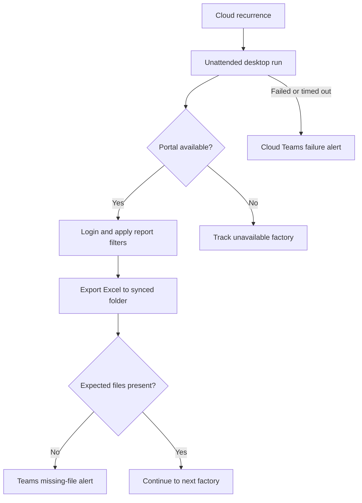

# GPRO Automation

**Unattended ERP report collection with Microsoft Power Automate Desktop.**

GPRO Automation collects production, quality and bundle-transaction reports from five factory portals. Desktop flows handle browser interaction and Excel downloads; scheduled cloud flows coordinate unattended execution and Microsoft Teams failure notifications.

Built by [Hasan Mahmood](https://github.com/NayemHasanLoLMan).

> **Repository format:** PAD actions are stored as sanitized `.txt` logic references, one subflow per file. Embedded UI definitions, screenshots and connector metadata have been removed. Rebuild UI elements and connections in PAD before use. These are not ready-to-import flows or a complete Power Platform solution.

## Workflows at a glance

| Workflow | Implementation | Scope |
| --- | --- | --- |
| [Daily operational](flows/desktop/daily-operational) | Main + login subflow | Bundle transactions across 44 configured factory checkpoints |
| [Daily quality](flows/desktop/daily-quality) | Main + login + 11 report subflows | 10 report subflows called; Weekly DHU included but not called |
| [Hourly quality](flows/desktop/hourly-quality) | Main + login + 6 report subflows | 5 report subflows called; Weekly DHU call disabled |

Factory configurations: **CIPL, GTL, PGCL, EGMCL7 and JDL**. File counts depend on portal availability, selected filters and successful exports; this repository does not claim verified production throughput.

## How it works

## Repository guide

| Location | Contents |
| --- | --- |
| [`flows/desktop/`](flows/desktop) | Three PAD workflows with original subflow filenames |
| [`flows/cloud/`](flows/cloud) | Two sanitized orchestration examples; not import packages |
| [`docs/setup.md`](docs/setup.md) | Prerequisites, configuration and first-run checklist |
| [`docs/pad-import-export.md`](docs/pad-import-export.md) | Why `.txt` is valid and how to restore subflows |
| [`docs/flow-catalog.md`](docs/flow-catalog.md) | Exact subflow names, active calls and checkpoints |
| [`docs/cloud-orchestration.md`](docs/cloud-orchestration.md) | Schedules, sequence, timeouts and dependencies |
| [`docs/troubleshooting.md`](docs/troubleshooting.md) | Browser, download, authentication and scheduling issues |
| [`docs/reference/`](docs/reference) | Explanation of excluded internal reference documents |
| [`docs/migration.md`](docs/migration.md) | Folder mapping and public sanitization changes |

## Quick start

1. Read [setup](docs/setup.md) and configure a dedicated Windows bot machine.
2. Reconstruct **one** desktop workflow using the [PAD guide](docs/pad-import-export.md).
3. Set local credentials, URLs, output paths and connection references; review captured UI elements.
4. Test one factory and one report interactively before enabling unattended execution.
5. Recreate the [cloud orchestrators](docs/cloud-orchestration.md) to your desktop flows and Teams connection, then verify the schedule.

The exported daily trigger is **22:30**, Saturday–Thursday, Bangladesh Standard Time. The hourly trigger is **07:00–22:00**, on the hour, on those same days. These values come from the JSON exports; some older Word documents describe different settings.

## Status and boundaries

This repository documents the supplied implementation. No Windows/PAD runtime test has been performed as part of the repository cleanup. The cloud examples require your own desktop-flow connections, including an hourly EGMCL7 flow whose source is not separately identified in this repository. Review [known limitations](docs/troubleshooting.md) before deployment.

Internal Word documents and original environment packages are excluded from the latest public tree. Earlier Git history may retain exposed credentials or links; see [security notes](SECURITY.md).

## Maintaining the project

See [contributing](CONTRIBUTING.md) for the export workflow and validation command. No license has been added; reuse permissions have not been specified by the owner.
